# Lab 04 – Bảo mật Web App và API

## 1. Thông tin sinh viên và mục tiêu

| Thông tin | Nội dung |
|---|---|
| Họ và tên | Lê Thị Hồng Thắm |
| MSSV | 2387700062 |
| Lớp | 23DATA1 |
| Trường | HUTECH |
| Bài thực hành | Lab 04 – Bảo mật Web App và API |

Em thực hành xây dựng Web Vulnerability Scanner để nhận diện dấu hiệu XSS, SQL Injection, CSRF và SSRF; đồng thời tìm hiểu JWT, OAuth 2.0, quản lý token và xác thực API Gateway. Các phép kiểm tra được thực hiện trong môi trường lab trên máy cá nhân.

**Minh chứng:** bộ ảnh gốc có 41 ảnh PNG: 32 ảnh Web (`lab4-1` đến `lab4-32`) và 9 ảnh JWT (`lab4-33` đến `lab4-42`, thiếu `lab4-37`). Bản công khai chèn 40 ảnh an toàn; ảnh `lab4-36` còn lộ token được giữ cục bộ. Các hình được trình bày theo thứ tự số; kết quả dưới đây chỉ dựa trên nội dung ảnh và mã nguồn.

## 2. Phần 4.2 – WebVulnScanner

### 2.1. Công cụ và cấu trúc dự án

| Thành phần | Chức năng triển khai |
|---|---|
| `XSSScanner` | Gửi hai payload mẫu qua tham số `q`, tìm chuỗi phản chiếu trong phản hồi HTTP |
| `SQLInjectionTester` | Phân tích query URL, so khớp các chuỗi SQLi trong giáo trình |
| `CSRFDetector` | Dùng regex kiểm tra các tên trường CSRF token trong HTML |
| `SSRFTester` | Tìm giá trị tham chiếu nội bộ trong query, không truy cập tài nguyên đó |
| `ReportGenerator` | Tổng hợp loại phát hiện, tham số, mức rủi ro và gợi ý khắc phục |

Cấu trúc mã nguồn gồm 19 file; không đưa cache Python vào cây dưới đây.

```text
web-vuln-scanner/
├── __init__.py
├── main.py
├── requirements.txt
├── scanners/
│   ├── __init__.py
│   ├── csrf_detector.py
│   ├── sql_injection_tester.py
│   ├── ssrf_tester.py
│   └── xss_scanner.py
├── report/
│   ├── __init__.py
│   └── report_generator.py
├── tests/
│   ├── __init__.py
│   ├── test_csrf.py
│   ├── test_sql_injection.py
│   ├── test_ssrf.py
│   ├── test_xss.py
│   └── test_report.py
└── ui/
    ├── app.py
    └── templates/
        ├── index.html
        └── result.html
```

Em kiểm tra cấu trúc trong Terminal của dự án bằng `tree /F /A`.

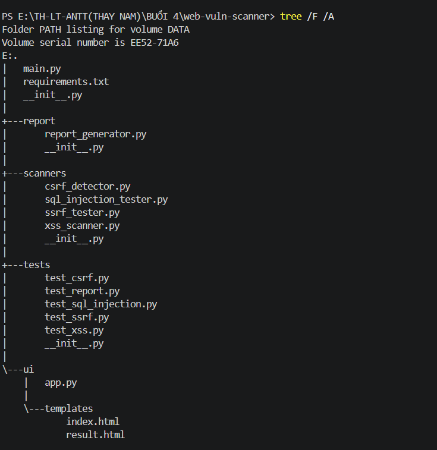

*Hình 4.1. Các module, testcase và template của WebVulnScanner.*

### 2.2. Chuẩn bị môi trường

Em làm việc trong dự án bằng VS Code và cài `Flask`, `requests` từ `requirements.txt`:

```powershell
python -m pip install -r requirements.txt
```

Ảnh có cảnh báo retry do timeout mạng, sau đó ghi `Successfully installed`. Đường dẫn thư viện sử dụng Python 3.14; kết quả `python --version` được ghi ở phần JWT.

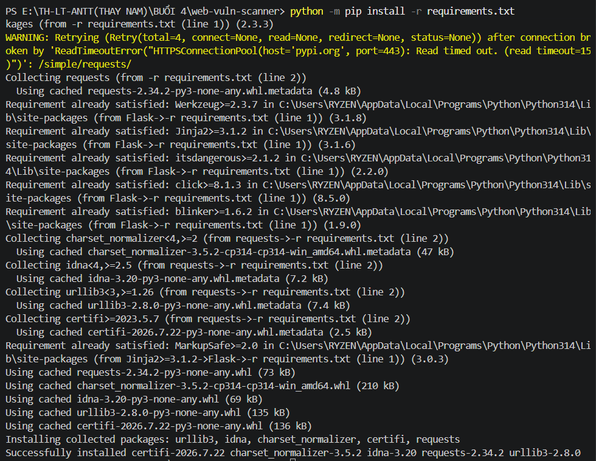

*Hình 4.2. Cài đặt các thư viện và thông báo kết thúc.*

### 2.3. Kiểm thử unittest

Để kiểm tra các scanner và bộ tổng hợp báo cáo, em chạy:

```powershell
python -m unittest discover tests -v
```

Terminal ghi **10 testcase, trạng thái `OK`**, thời gian hiển thị `0.003s`. Test XSS dùng mock HTTP; các test SQLi/SSRF phân tích dữ liệu URL.

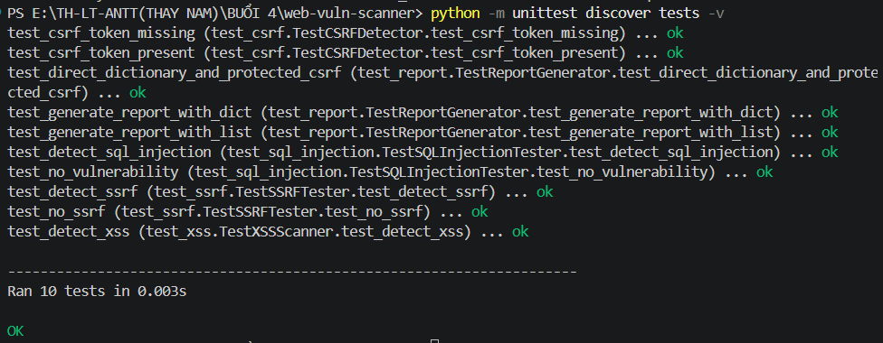

*Hình 4.3. Kết quả unittest thực tế của WebVulnScanner.*

### 2.4. Chạy chương trình chính

```powershell
python main.py
```

Main chạy **demo offline, phản hồi HTTP được mock**. Báo cáo hiển thị XSS ở `q` mức `HIGH`, SQLi ở `id` mức `CRITICAL`, SSRF ở `url` mức `HIGH`; mẫu HTML có trường CSRF token. Đây là kiểm tra tổng hợp bằng dữ liệu mẫu, không phải xác nhận website thực tế có lỗ hổng.

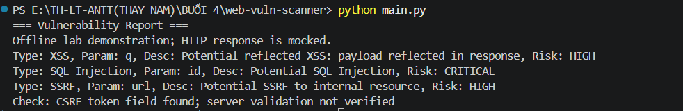

*Hình 4.4. Kết quả demo offline và trạng thái trường CSRF token.*

### 2.5. Chạy giao diện Flask

```powershell
python ui/app.py
```

Em mở `http://127.0.0.1:5000/`. Terminal ghi Flask chạy trên loopback, debug tắt; trình duyệt hiển thị ô URL và bốn checkbox scanner.

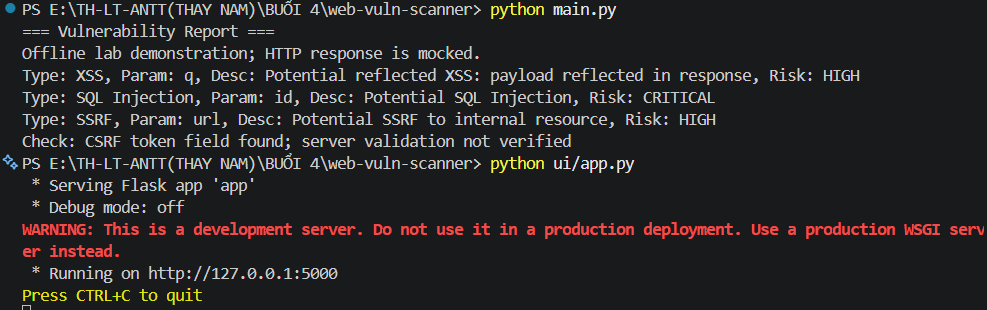

*Hình 4.5. Lệnh chạy UI và địa chỉ server cục bộ.*

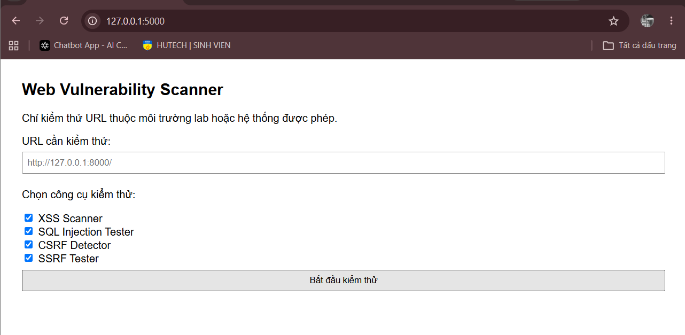

*Hình 4.6. Form nhập URL và chọn công cụ kiểm tra.*

### 2.6. Kiểm thử CSRF

Em nhập `http://127.0.0.1:5000/?q=sample`, chọn các scanner và bắt đầu kiểm tra. Đây là chính trang giao diện scanner; kết quả báo không thấy CSRF token, mức `MEDIUM`. Phép kiểm tra chỉ tìm tên trường trong HTML, chưa xác minh khả năng khai thác CSRF hoặc kiểm tra token phía server.

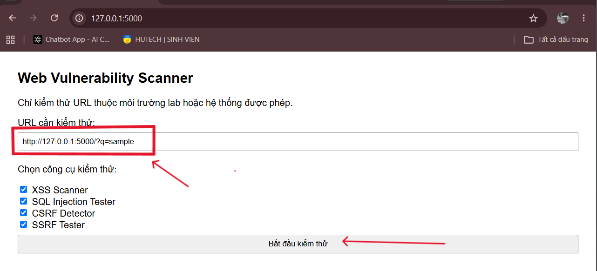

*Hình 4.7. URL và lựa chọn công cụ trước khi gửi form.*

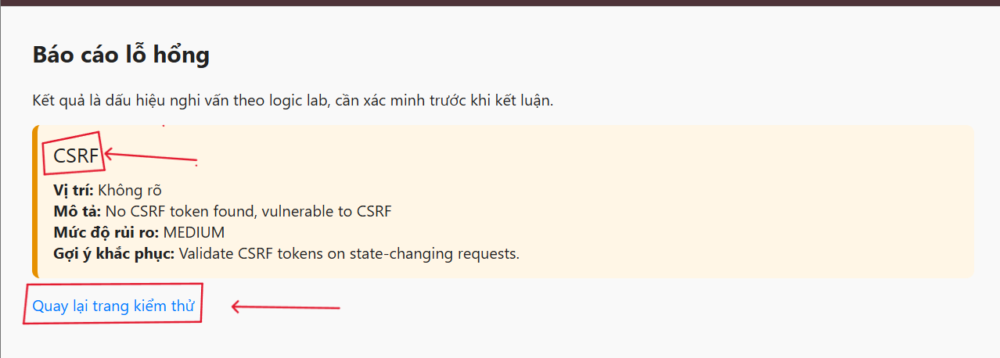

*Hình 4.8. Báo cáo thiếu trường CSRF token trong trang được kiểm tra.*

### 2.7. Kiểm thử SQL Injection

Em nhập các query vào URL `http://127.0.0.1:5001/item`. Scanner nhận diện payload trong tham số và báo `Potential SQL Injection`, mức `CRITICAL`.

**Các ảnh kết quả dưới đây đồng thời có lỗi kết nối cổng 5001 của XSS/CSRF.** SQLi vẫn có kết quả vì chỉ phân tích chuỗi URL, không gửi truy vấn đến database. Không kết luận đã khai thác SQL Injection thành công.

Trường hợp thứ nhất: tham số `id` chứa `' OR '1'='1`.

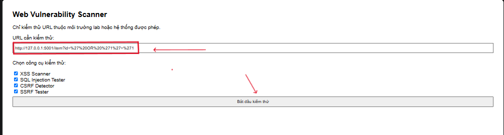

*Hình 4.9. Dữ liệu đầu vào SQLi nháy đơn.*

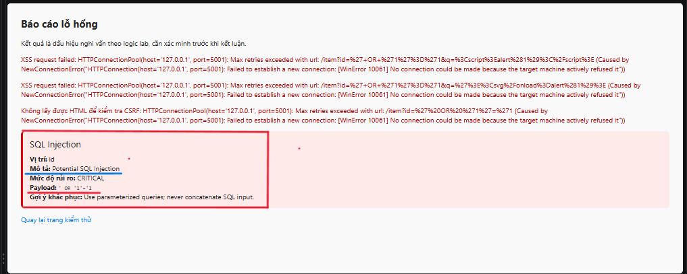

*Hình 4.10. Dấu hiệu SQLi tại id và lỗi HTTP của các scanner khác.*

Trường hợp thứ hai: tham số `id` chứa `" OR 1=1--`.

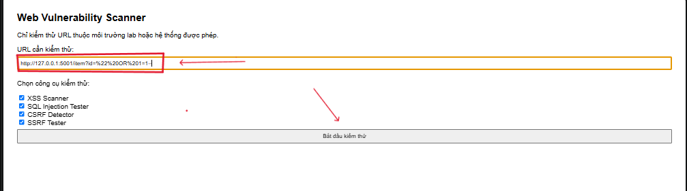

*Hình 4.11. Dữ liệu đầu vào SQLi nháy kép.*

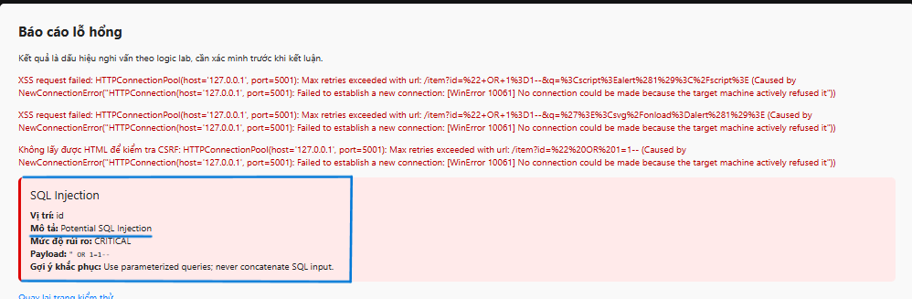

*Hình 4.12. Payload khớp thư viện của SQLInjectionTester.*

Trường hợp thứ ba: tham số `id` chứa `' UNION SELECT NULL--`.

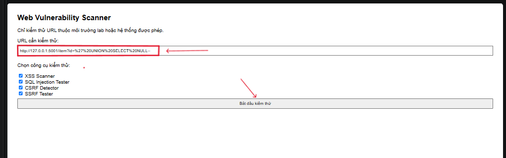

*Hình 4.13. Dữ liệu đầu vào dạng UNION.*

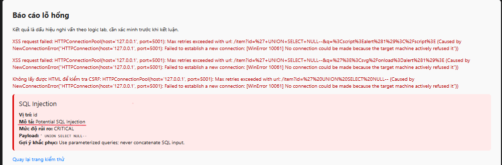

*Hình 4.14. Kết quả so khớp payload UNION, mức CRITICAL.*

Trường hợp thứ tư: chuyển payload `' OR '1'='1` sang tham số `user`.

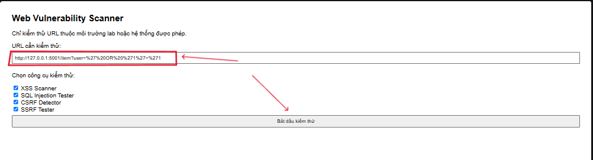

*Hình 4.15. Kiểm tra tham số khác id.*

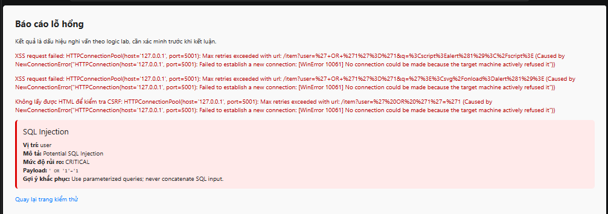

*Hình 4.16. Báo cáo xác định tham số user và payload nghi vấn.*

### 2.8. Kiểm thử SSRF

Em kiểm tra query `url` của `http://127.0.0.1:5001/fetch`. Các giá trị nội bộ dưới đây được so khớp bằng regex và báo `Potential SSRF to internal resource`, mức `HIGH`. Module không chủ động kết nối đến URL nằm trong tham số; lỗi XSS/CSRF trong ảnh vẫn là lỗi kết nối server đích ở cổng 5001.

Giá trị thứ nhất: `http://localhost/admin`.

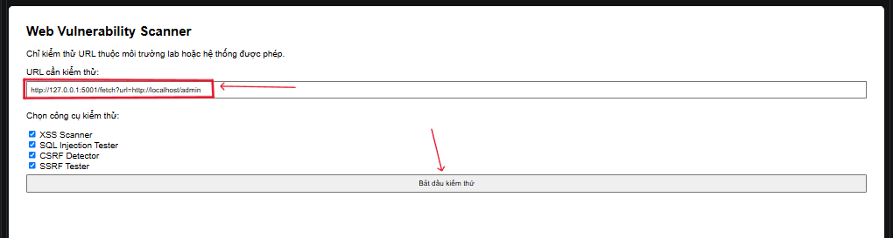

*Hình 4.17. Query url chứa localhost.*

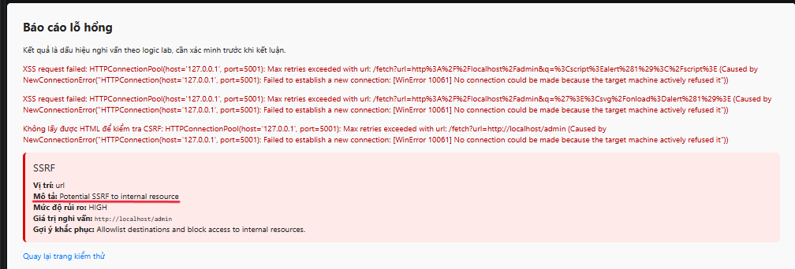

*Hình 4.18. Dấu hiệu SSRF tại tham số url, mức HIGH.*

Giá trị thứ hai: `http://127.0.0.1:8080/admin`.

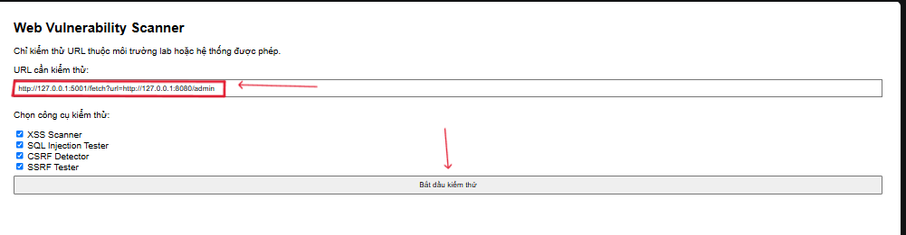

*Hình 4.19. Query url chứa địa chỉ loopback.*

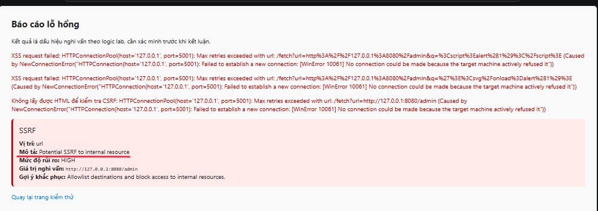

*Hình 4.20. Giá trị nội bộ được ghi trong báo cáo SSRF.*

Giá trị thứ ba: `http://192.168.1.10/status`.

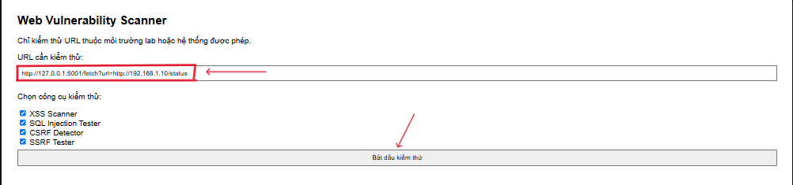

*Hình 4.21. Query url chứa địa chỉ mạng riêng 192.168.*

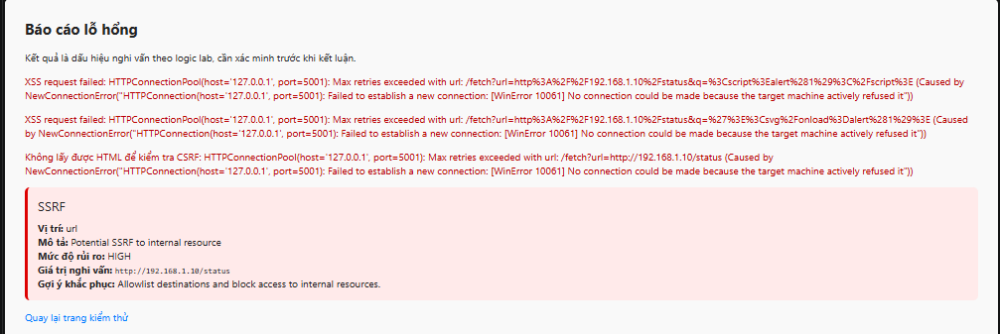

*Hình 4.22. Kết quả so khớp địa chỉ mạng riêng.*

Giá trị thứ tư: `http://10.0.0.5/metrics`.

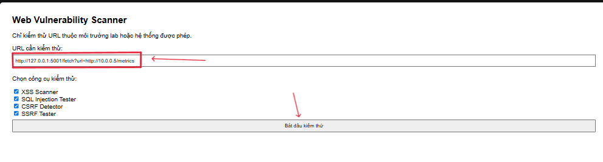

*Hình 4.23. Query url chứa địa chỉ mạng riêng 10.x.*

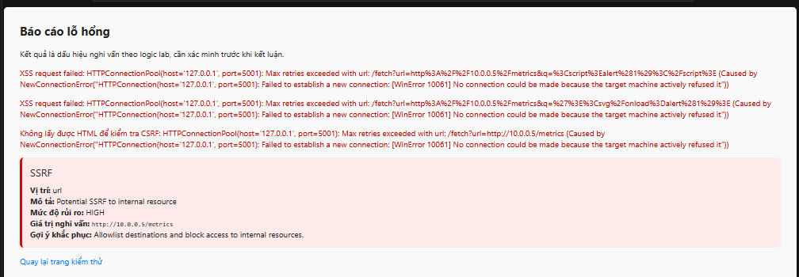

*Hình 4.24. Dấu hiệu SSRF với giá trị 10.0.0.5.*

Em cũng nhập `http://172.16.0.2/admin`; tập ảnh hiện chỉ có form đầu vào, chưa có ảnh kết quả riêng của trường hợp này.

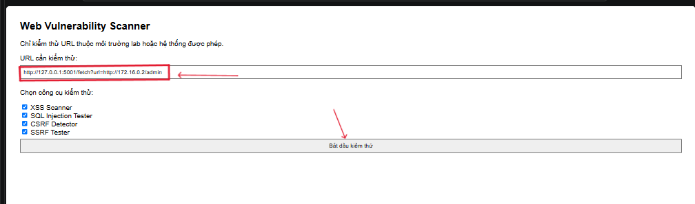

*Hình 4.25. Dữ liệu đầu vào thuộc dải mạng riêng 172.16.*

### 2.9. Kiểm thử XSS qua giao diện

Em nhập URL `http://127.0.0.1:5001/search` với query `q` chứa `<script>alert(1)</script>`. XSSScanner gửi hai payload đã khai báo trong mã. Các lần kiểm tra trong ảnh bị từ chối kết nối (`WinError 10061`), nên **chưa có minh chứng phát hiện XSS qua HTTP thực tế**; kết quả XSS trong main/unittest ở trên sử dụng mock.

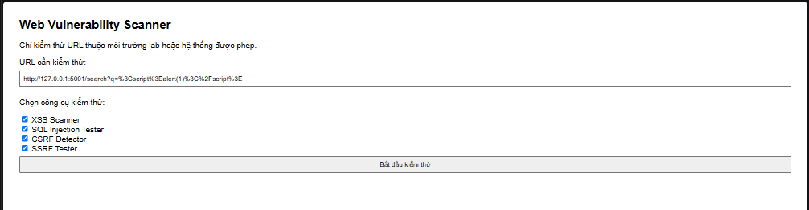

*Hình 4.26. URL đầu vào cho phép kiểm tra XSS.*

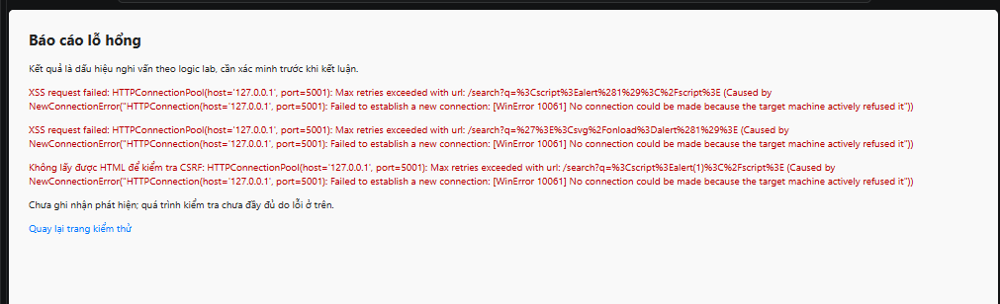

*Hình 4.27. XSS/CSRF không nhận được phản hồi từ server cổng 5001.*

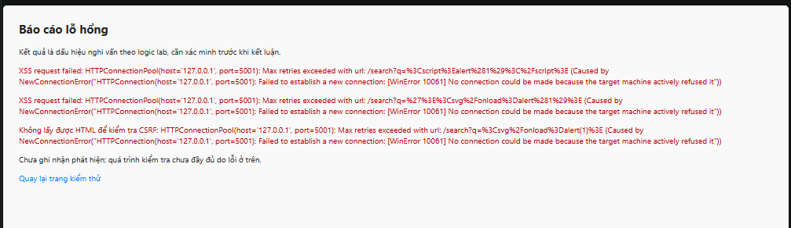

*Hình 4.28. Chương trình ghi rõ quá trình kiểm tra chưa đầy đủ.*

Em thử đầu vào `q=`. Theo mã nguồn, scanner thay `q` bằng payload script/svg của nó; đầu vào này không bổ sung một payload mới vào thư viện.

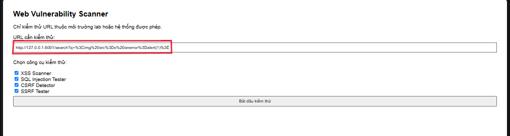

*Hình 4.29. Trường hợp đầu vào img/onerror.*

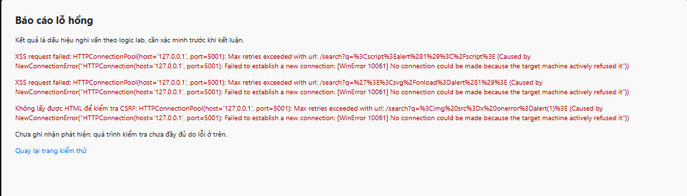

*Hình 4.30. Không có kết luận XSS thành công khi request bị lỗi.*

### 2.10. Báo cáo tổng hợp

Em nhập cùng lúc `id=' OR '1'='1` và `url=http://127.0.0.1:8080/admin` vào query của `/fetch`.

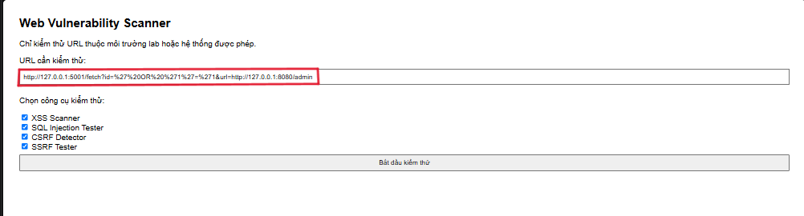

*Hình 4.31. Đầu vào cho kiểm tra tổng hợp.*

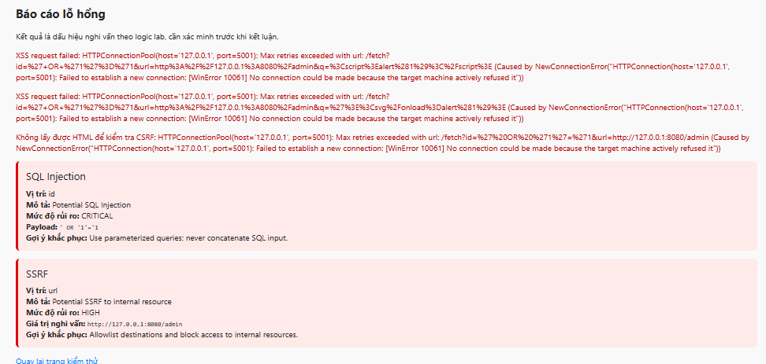

*Hình 4.32. ReportGenerator hiển thị SQLi mức CRITICAL và SSRF mức HIGH; XSS/CSRF báo lỗi HTTP.*

**Nhận xét:** bộ công cụ có đủ bốn scanner, báo cáo và UI; unittest đạt 10 test. Các phát hiện SQLi/SSRF là dấu hiệu theo dữ liệu URL. Regex CSRF và phép tìm payload phản chiếu chưa chứng minh khai thác; các lần kiểm tra Web cổng 5001 còn lỗi kết nối.

## 3. Phần 4.4 – JWTSecure

### 3.1. Công cụ và cấu trúc dự án

JWT Security Tools gồm validator, cracker khóa yếu cho token lab, OAuth client, bộ quản lý token và Flask API Gateway. Mã nguồn gồm 19 file:

```text
jwt-security-tools/
├── main.py
├── pytest.ini
├── requirements.txt
├── api_gateway/
│   ├── __init__.py
│   └── gateway.py
├── jwt_cracker/
│   ├── __init__.py
│   └── cracker.py
├── jwt_validator/
│   ├── __init__.py
│   └── validator.py
├── oauth_client/
│   ├── __init__.py
│   └── client.py
├── token_manager/
│   ├── __init__.py
│   └── manager.py
└── tests/
    ├── __init__.py
    ├── test_api_gateway.py
    ├── test_cracker.py
    ├── test_oauth_client.py
    ├── test_token_manager.py
    └── test_validator.py
```

Em kiểm tra cây thư mục trong Terminal bằng `tree /F /A`.

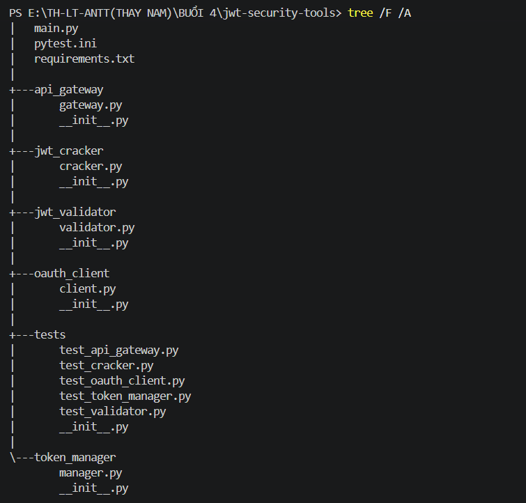

*Hình 4.33. Các module JWT, OAuth, API Gateway và testcase.*

### 3.2. Chuẩn bị môi trường

Trong Terminal dự án, em kiểm tra Python và chạy cài dependencies:

```powershell
python --version
python -m pip install -r requirements.txt
```

Ảnh xác nhận **Python 3.14.7** và quá trình cài từ `requirements.txt` gồm PyJWT, requests, Flask, pytest. Ảnh bị cắt trước phần tổng kết cài đặt; không suy ra thông báo kết thúc từ ảnh này.

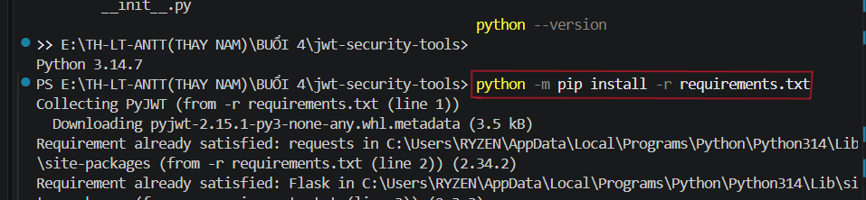

*Hình 4.34. Kiểm tra Python 3.14.7 và bắt đầu cài dependencies.*

### 3.3. Cấu hình và chạy pytest

```ini
[pytest]
pythonpath = .
```

Em đọc cấu hình rồi chạy test:

```powershell
Get-Content .\pytest.ini
python -m pytest tests/ -v
```

Ảnh ghi **thu thập 12 testcase** và thể hiện **4 testcase đầu PASSED**: gateway nhận token hợp lệ, từ chối token sai, từ chối refresh token/thiếu header và thử khóa yếu của token lab. **Chưa có ảnh dòng tổng kết để xác minh 12/12 test thành công.**

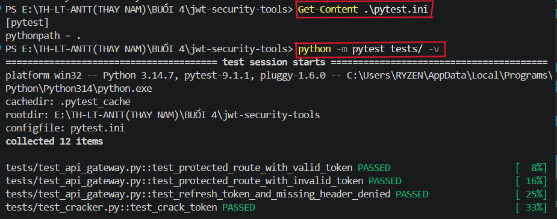

*Hình 4.35. Pytest thu thập 12 test; ảnh thể hiện bốn kết quả PASSED đầu tiên.*

### 3.4. Chạy main và khởi động API Gateway

```powershell
python main.py
```

Mã main phát hành Access Token và Refresh Token mẫu cho định danh `phuoc`, dùng cấu hình lab công khai, rồi mở gateway tại `http://127.0.0.1:5000`. Access Token có thời hạn 15 phút, Refresh Token 24 giờ theo cấu hình mặc định.

**Hình 4.36:** ảnh gốc `lab4-36.png` thể hiện lệnh main, server và hai token nhưng còn lộ thông tin xác thực. Ảnh này chưa được chèn vào bản công khai; cần bản sao đã che vùng token, giữ nguyên kết quả còn lại. Tập ảnh không có `lab4-37.png`.

Ảnh tiếp theo ghi `Not Found` khi mở `/`: gateway chỉ khai báo `/protected`, nên trang gốc không có route.

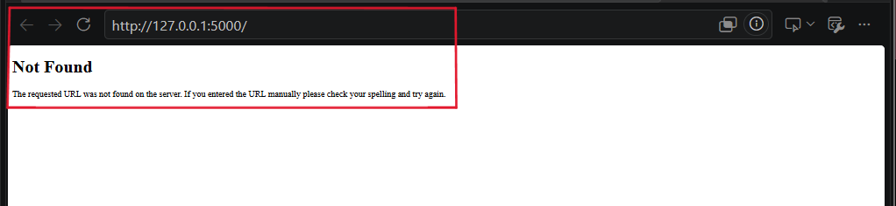

*Hình 4.38. Trang gốc trả Not Found, không phải kết quả xác thực JWT.*

### 3.5. Truy cập protected khi chưa có header

Em mở `http://127.0.0.1:5000/protected` trong trình duyệt. JSON hiển thị `{"message":"Access denied"}`. Ảnh không có HTTP status hoặc header request; đây là minh chứng nội dung phản hồi khi mở trực tiếp bằng trình duyệt, không phải ảnh curl kiểm tra thiếu token kèm status.

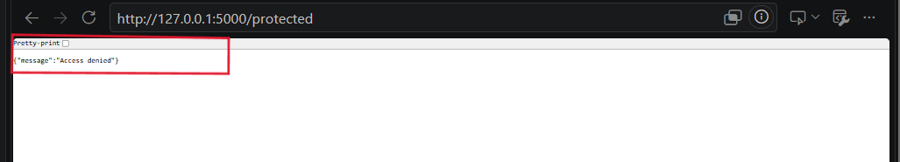

*Hình 4.39. Gateway từ chối truy cập khi mở trực tiếp trang protected.*

### 3.6. Kiểm tra Access Token hợp lệ

Em nhập token vào Terminal bằng chế độ `SecureString`, nội dung nhập được che:

```powershell
$secureToken = Read-Host "Nhap Access Token" -AsSecureString
```

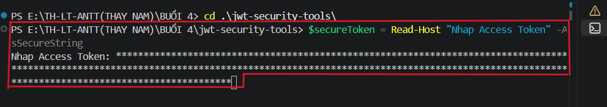

*Hình 4.40. Không hiển thị giá trị token khi nhập.*

Ảnh request tiếp theo dùng biến `$token`; bước chuyển từ `$secureToken` sang biến này không nằm trong ảnh, nên không bổ sung thành một thao tác đã có minh chứng.

```powershell
curl.exe -i -H "Authorization: Bearer $token" http://127.0.0.1:5000/protected
```

Phản hồi thực tế: **HTTP 200 OK** và JSON:

```json
{"message":"Access granted","user":"phuoc"}
```

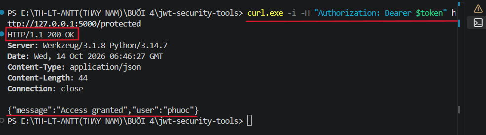

*Hình 4.41. HTTP 200 OK và nội dung Access granted.*

### 3.7. Kiểm tra token không hợp lệ

```powershell
curl.exe -i -H "Authorization: Bearer invalid" http://127.0.0.1:5000/protected
```

Phản hồi thực tế: **HTTP 401 Unauthorized** và JSON:

```json
{"message":"Access denied"}
```

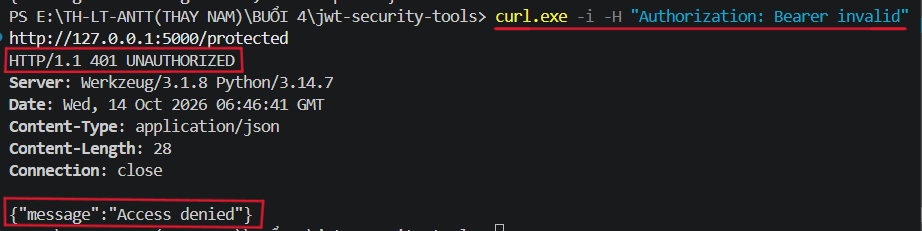

*Hình 4.42. HTTP 401 Unauthorized với token không hợp lệ.*

### 3.8. Tổng hợp chức năng và phạm vi kiểm thử

| Thành phần | Chức năng trong mã | Minh chứng hiện có |
|---|---|---|
| `JWTValidator` | Xác minh chữ ký và thời hạn; xử lý token sai/hết hạn/thiếu exp | Có test đúng/sai chữ ký, hết hạn, thiếu exp; ảnh pytest chưa thể hiện kết quả của các test này |
| `JWTCracker` | Dùng wordlist cục bộ và ThreadPoolExecutor với JWT lab HS256 | `test_crack_token` PASSED ở hình 4.35 |
| `OAuthClient` | Tạo URL ủy quyền, đổi code qua requests, hỗ trợ state tùy chọn | Có test URL và đổi code dùng mock; chưa có minh chứng OAuth provider thật hoặc kết quả cuối pytest |
| `TokenManager` | Phát hành, làm mới và thu hồi refresh token trong RAM | Main phát hành token mẫu; có testcase làm mới/thu hồi nhưng chưa thấy kết quả tương ứng trong ảnh pytest |
| `APIGateway` | Kiểm tra Bearer, chữ ký, exp và loại access trước khi cấp quyền | Ba test gateway PASSED trong hình 4.35; request trực tiếp HTTP 200/401 ở hình 4.41–4.42 |

Thu hồi refresh token theo `jti` là phần bổ sung so với code mẫu trang 25, nhằm đáp ứng mục tiêu trang 21. Trạng thái thu hồi chỉ tồn tại trong tiến trình. OAuthClient chưa triển khai callback xác minh state hoặc PKCE; bộ công cụ chưa được đánh giá để dùng trong môi trường vận hành thực tế.

## 4. Kết luận

Em thực hành hai công cụ WebVulnScanner và JWT Security Tools theo Lab 04.<br>
WebVulnScanner có đủ scanner, báo cáo và UI; ảnh unittest xác nhận 10 testcase OK.<br>
UI nhận diện dấu hiệu SQLi/SSRF trong query và phân tích thiếu trường CSRF token ở trang cục bộ.<br>
Các lần kiểm tra XSS/CSRF tại cổng 5001 còn lỗi kết nối; kết quả XSS offline sử dụng mock.<br>
Pytest thu thập 12 test, nhưng ảnh hiện chỉ xác minh bốn test đầu PASSED.<br>
API Gateway trả HTTP 200 với Access Token hợp lệ và HTTP 401 với Bearer invalid.<br>
Qua bài thực hành, em phân biệt dấu hiệu nghi vấn với khai thác thành công và hiểu vai trò của chữ ký, thời hạn, loại token trong xác thực API.

## 5. Tài liệu tham khảo

Các nguồn đã dùng khi đối chiếu nội dung và mã nguồn:

- [Lab 04 – Bảo mật Web App và API](./lab-04.pdf): phần 4.2, trang 5–18; phần 4.4, trang 21–29.
- [Tài liệu Flask](https://flask.palletsprojects.com/en/stable/quickstart/).
- [Tài liệu unittest của Python](https://docs.python.org/3.14/library/unittest.html).
- [Tài liệu pytest về tmp_path](https://docs.pytest.org/en/stable/how-to/tmp_path.html).
- [Tài liệu PyJWT](https://pyjwt.readthedocs.io/en/stable/usage.html).
