# LAB 5 – PHÂN TÍCH VÀ KIỂM THỬ BẢO MẬT (SAST & DAST)

Bài thực hành học phần **Lập trình An ninh Thông tin** gồm phần **5.2 – SAST-TOOL** và **5.4 – DAST-TOOL** theo tài liệu Lab 5 của học phần. Bản PDF không nằm trong bộ file xuất bản này. SAST phân tích mã Python; DAST quan sát tài nguyên tiến trình và cung cấp các API giám sát bằng Flask.

README được đối chiếu với mã nguồn, báo cáo đang lưu và **26 ảnh gốc** trong `image/`. Kết quả kiểm thử dưới đây lấy từ minh chứng đã chụp, không phải kết quả chạy lại khi viết tài liệu. Các số liệu CPU, RAM và mạng chỉ phản ánh thời điểm chụp ảnh.

## 1. Mục tiêu bài thực hành

- Phân tích bảo mật tĩnh bằng cây cú pháp **AST**.
- Nhận diện các mẫu mã nguy hiểm và kiểm tra chất lượng mã bằng `flake8`.
- Xuất báo cáo `.sarif` và xem kết quả bằng SARIF Viewer.
- Giám sát CPU, RAM, file đang mở và thống kê lưu lượng mạng.
- Thực hành các phép kiểm tra bộ nhớ, mẫu hành vi và ví dụ thực thi trong thư mục tạm.
- Xây dựng, kiểm thử các endpoint giám sát bằng Flask.

## 2. Môi trường và công cụ

Các phiên bản dưới đây được đọc trực tiếp từ máy và hai môi trường Python khi lập README; không mặc định đây là phiên bản của mọi lần kiểm thử trước đó.

| Thành phần | Phiên bản / thông tin xác nhận |
|---|---|
| Hệ điều hành | Microsoft Windows 11 Pro, `10.0.26300` |
| Python | **3.14.7**; ảnh 3 cũng xác nhận phiên bản trong môi trường SAST |
| PowerShell của phiên kiểm tra tài liệu | 7.6.5 |
| Visual Studio Code | 1.141.1, x64 |
| SARIF Viewer | `ms-sarifvscode.sarif-viewer` **3.4.5** |
| SAST | `flake8` **7.4.1**, `sarif-om` **1.0.4**, `jsonpickle` **4.1.4** |
| DAST | `psutil` **7.2.2**, `Flask` **3.1.3**, `Werkzeug` **3.1.9** |
| Kiểm thử | `unittest`, trình duyệt, `Invoke-RestMethod`, `curl.exe` |
| Môi trường Python | Mỗi project có một `.venv` riêng; các lệnh dưới đây gọi trực tiếp Python trong đó |

Các thư viện chuẩn được sử dụng gồm `ast`, `re`, `json`, `pathlib`, `gc`, `os`, `subprocess`, `tempfile`, `sys` và `unittest`. Các gói phụ thuộc được `pip` cài theo hai file `requirements.txt`.

## 3. Cấu trúc thư mục thực tế

Cây dưới đây lược bỏ môi trường ảo và bộ nhớ đệm Python. `report.sarif` đã tồn tại và hiện lưu kết quả của file ví dụ thứ hai.

```text
BUỔI 5/
├── sast-tool/
│   ├── examples/
│   │   ├── vulnerable_01.py
│   │   └── vulnerable_02.py
│   ├── rules/
│   │   └── default_rules.json
│   ├── sast_tool/
│   │   ├── __init__.py
│   │   ├── ast_analyzer.py
│   │   ├── code_quality_checker.py
│   │   ├── main.py
│   │   ├── sarif_reporter.py
│   │   ├── security_rule_engine.py
│   │   └── vuln_pattern_matcher.py
│   ├── tests/
│   │   ├── __init__.py
│   │   ├── test_ast_analyzer.py
│   │   ├── test_code_quality_checker.py
│   │   ├── test_sarif_reporter.py
│   │   ├── test_security_rule_engine.py
│   │   └── test_vuln_pattern_matcher.py
│   ├── report.sarif
│   └── requirements.txt
├── dast-tool/
│   ├── tests/
│   │   ├── __init__.py
│   │   ├── test_memory_analyzer.py
│   │   ├── test_network_traffic_analyzer.py
│   │   ├── test_runtime_monitor.py
│   │   ├── test_security_behavior_checker.py
│   │   └── test_virtual_sandbox.py
│   ├── __init__.py
│   ├── app.py
│   ├── main.py
│   ├── memory_analyzer.py
│   ├── network_traffic_analyzer.py
│   ├── requirements.txt
│   ├── runtime_monitor.py
│   ├── security_behavior_checker.py
│   └── virtual_sandbox.py
├── image/
│   └── lab5-1.png … lab5-26.png  (26 file PNG)
├── .gitignore
└── README.md
```

`examples/` chứa mã mẫu để phân tích, `rules/` chứa cấu hình luật và `tests/` chứa Unit Test. `sast_tool/main.py` điều phối phân tích; `dast-tool/main.py` chạy ví dụ giám sát; `dast-tool/app.py` công bố các endpoint.

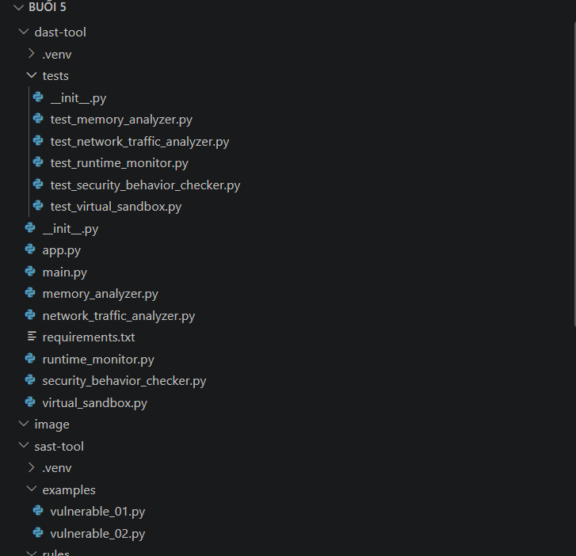

*Hình 1. Cấu trúc dùng chung: toàn bộ phần DAST và một phần SAST trong Explorer.*

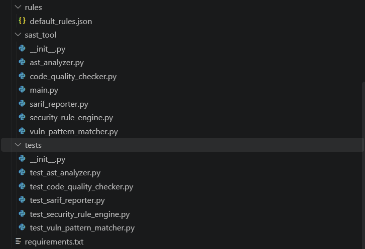

*Hình 2. Các module, cấu hình và file kiểm thử SAST.*

## 4. Quy ước thao tác

Các lệnh cài đặt và kiểm thử dưới đây dùng **Windows PowerShell**. Chuyển đúng thư mục project trước khi chạy. Chỉ chạy `python -m venv .venv` khi project chưa có môi trường ảo. Không cần kích hoạt môi trường nếu gọi `.\.venv\Scripts\python.exe` bằng đường dẫn tương đối như trong các ví dụ.

Mã trong `examples/` được đọc để phân tích tĩnh; không cần thực thi trực tiếp. Mỗi lần quét sẽ ghi lại `report.sarif`, vì vậy báo cáo hiện tại không đồng thời lưu cả hai lượt quét.

## 5. PHẦN I – SAST-TOOL

### 5.1. Giới thiệu SAST-TOOL

Công cụ đọc một file Python, phát hiện lời gọi `eval()`, so khớp hai mẫu mã đáng ngờ, chạy `flake8`, áp dụng luật và ghi kết quả ra `report.sarif`. Tổng số kết quả gồm cả cảnh báo bảo mật và lỗi quy cách mã; không đồng nghĩa với số lỗ hổng có thể khai thác.

### 5.2. Các thành phần của SAST-TOOL

| Thành phần | Chức năng trong mã hiện tại |
|---|---|
| `ASTAnalyzer` | Duyệt cây AST, nhận diện lời gọi trực tiếp `eval()` và ghi dòng/cột |
| `VulnPatternMatcher` | Dùng biểu thức chính quy tìm phép gán biến `password` bằng chuỗi nháy kép và câu lệnh `import pickle` |
| `SecurityRuleEngine` | Đọc `default_rules.json`, gắn mức độ cho kết quả AST và pattern matching |
| `CodeQualityChecker` | Chạy `flake8` bằng Python hiện hành, chuyển đầu ra thành các mục `Lint Issue` |
| `SarifReporter` | Tạo mô hình SARIF 2.1.0 với `sarif-om`, tuần tự hóa bằng `jsonpickle` |

File luật khai báo mức `high`, `medium`, `low`. Tuy nhiên, `main.py` ghép cảnh báo lint sau bước áp luật và reporter chưa ánh xạ trường `severity` sang mức cảnh báo SARIF. Không nên hiểu màu cảnh báo trong Viewer là mức độ đã được phân loại đầy đủ.

### 5.3. Cài đặt và chạy chương trình

**Mục đích:** xác nhận đúng môi trường và đủ dependencies.

```powershell
Set-Location -LiteralPath 'E:\TH-LT-ANTT(THAY NAM)\BUỔI 5\sast-tool'
# Chỉ thực hiện dòng sau nếu chưa có .venv:
python -m venv .venv
.\.venv\Scripts\python.exe -m pip install -r .\requirements.txt
.\.venv\Scripts\python.exe --version
.\.venv\Scripts\python.exe -m pip show flake8 sarif-om jsonpickle
.\.venv\Scripts\python.exe -m pip check
```

**Kết quả thực tế:** Python **3.14.7**; ba thư viện SAST đã được cài; `pip check` trả về `No broken requirements found.`

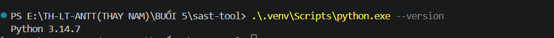

*Hình 3. Phiên bản Python trong `.venv` của SAST.*

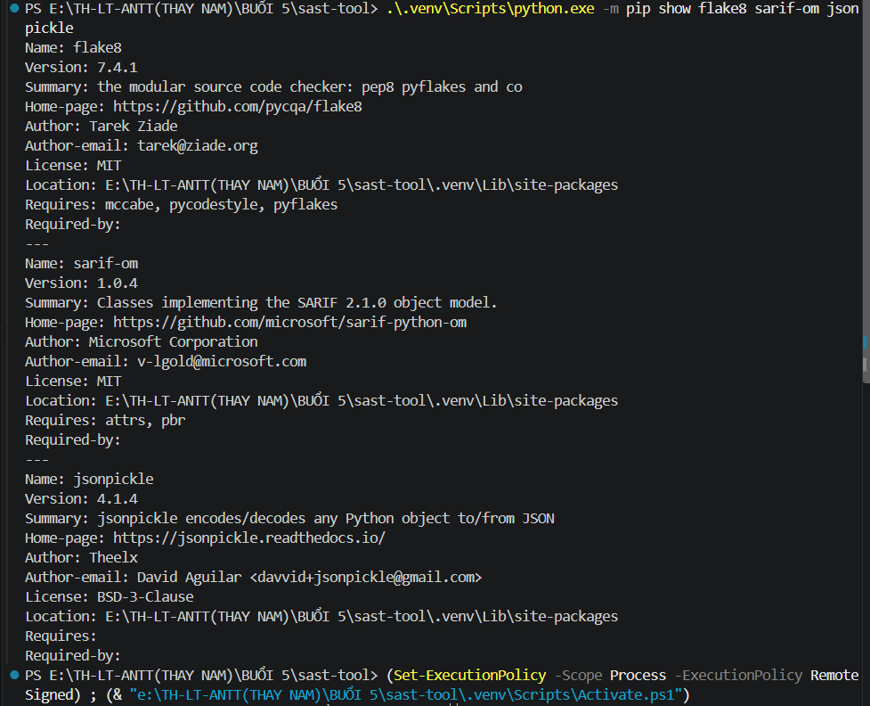

*Hình 4. Xác nhận phiên bản và vị trí cài ba thư viện SAST.*

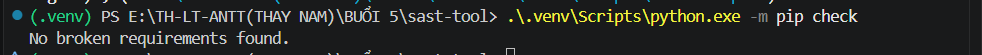

*Hình 5. Dependencies SAST không có yêu cầu bị thiếu hoặc xung đột theo `pip check`.*

### 5.4. Kiểm thử Unit Test

**Mục đích:** kiểm tra nhận diện `eval`, hai mẫu regex, luật bảo mật, đầu ra lint và việc tạo file báo cáo.

```powershell
.\.venv\Scripts\python.exe -m unittest discover -s tests -v
```

**Kết quả thực tế:** **6 test**, **0,412 giây**, kết thúc **OK**. Có `DeprecationWarning` của `jsonpickle` về giá trị mặc định `keys` ở phiên bản 5.0.0; đây là cảnh báo tương thích tương lai, không làm lần chạy trong ảnh thất bại.

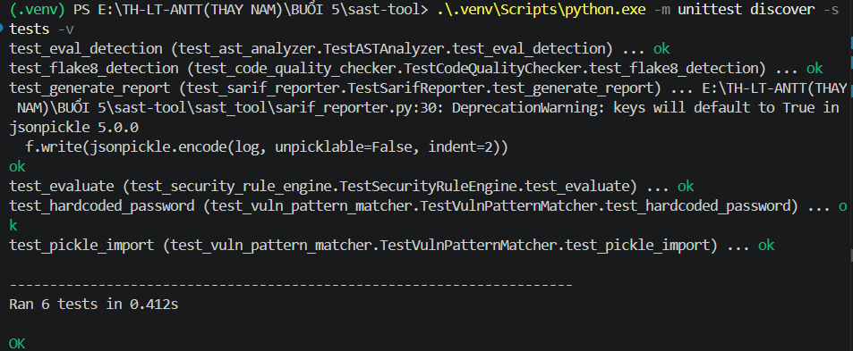

*Hình 6. Cả sáu test SAST hoàn thành với trạng thái OK.*

### 5.5. Phân tích file vulnerable_01.py

**Mục đích:** phát hiện các mẫu không an toàn và lỗi quy cách trong file ví dụ thứ nhất.

```powershell
.\.venv\Scripts\python.exe -m sast_tool.main .\examples\vulnerable_01.py
Test-Path .\report.sarif
```

**Kết quả thực tế:** terminal báo **8 cảnh báo** và `Test-Path` trả về `True`.

| Loại kết quả | Nội dung | Vị trí đối chiếu |
|---|---|---|
| AST | Sử dụng `eval()` | Dòng 6 trong mã nguồn |
| Pattern | Mật khẩu được ghi trực tiếp trong mã | Dòng 1 trong mã nguồn; không trích giá trị vào README |
| Pattern | Sử dụng `pickle` có thể không an toàn | Dòng 3 trong mã nguồn |
| F401 | Import `pickle` nhưng chưa sử dụng | Dòng 3 |
| E402 | Import không nằm đầu module | Dòng 3 |
| E302 | Thiếu dòng trống trước định nghĩa hàm | Dòng 5 và 8, hai cảnh báo |
| E305 | Thiếu dòng trống sau định nghĩa hàm | Dòng 11 |

Các cảnh báo lint và thông điệp bảo mật được nhìn thấy trong ảnh 9; vị trí ba cảnh báo bảo mật được đối chiếu với mã nguồn, không phải vị trí điều hướng đã hoạt động trong Viewer.

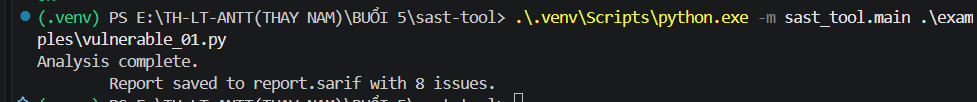

*Hình 7. Công cụ hoàn tất phân tích file thứ nhất với 8 kết quả.*

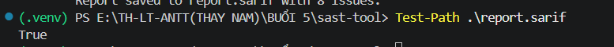

*Hình 8. `Test-Path` xác nhận đã có file báo cáo.*

### 5.6. Kiểm tra báo cáo SARIF

**Thao tác:** trong Extensions của VS Code, tìm **SARIF Viewer** của Microsoft và cài nếu chưa có. Mở `report.sarif`, dùng chức năng mở log của SARIF Viewer để nạp file, sau đó xem các thẻ **LOCATIONS**, **RULES**, **LOGS**.

**Kết quả thực tế:** Viewer nạp được **8 kết quả**. Tuy nhiên, LOCATIONS hiển thị **No Location**, cột dòng/file chưa có giá trị và Rule Id chưa hiển thị. Bộ ảnh chưa chứng minh chức năng nhảy đến dòng mã hoạt động đúng.

Đối chiếu file hiện tại cho thấy các thuộc tính được tuần tự hóa dạng `physical_location`, `artifact_location`, `start_line` thay vì tên trường SARIF dạng camelCase. Đây là hạn chế của cách xuất hiện tại cần xử lý trước khi khẳng định tương thích đầy đủ với chuẩn SARIF và điều hướng vị trí. README ghi nhận hiện trạng; mã nguồn không được sửa trong lần lập tài liệu này.

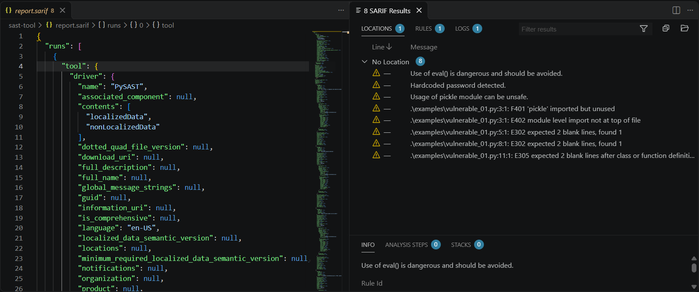

*Hình 9. Thẻ LOCATIONS hiển thị thông điệp của 8 cảnh báo nhưng chưa nhận diện vị trí.*

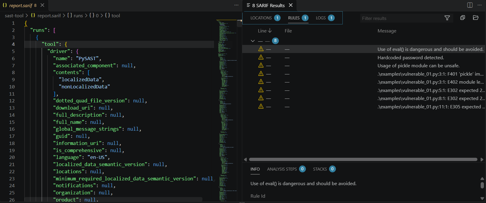

*Hình 10. Thẻ RULES hiển thị danh sách kết quả; thông tin quy tắc và vị trí còn thiếu.*

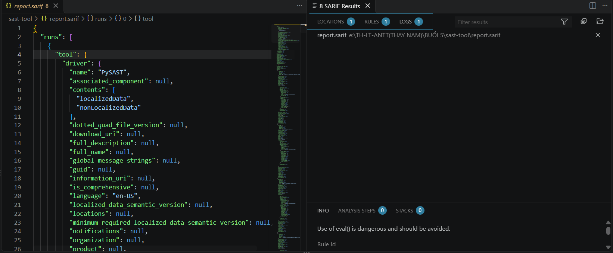

*Hình 11. Thẻ LOGS ghi nhận file báo cáo đang được mở.*

### 5.7. Phân tích file vulnerable_02.py

```powershell
.\.venv\Scripts\python.exe -m sast_tool.main .\examples\vulnerable_02.py
```

**Kết quả thực tế:** ảnh 12 xác nhận **4 cảnh báo**. Đọc `sast-tool/report.sarif` hiện tại cho thấy một cảnh báo `eval()` ở dòng 3, hai lỗi **E302** ở dòng 5 và 10, một lỗi **E305** ở dòng 13. File báo cáo hiện tại thuộc lần quét thứ hai.

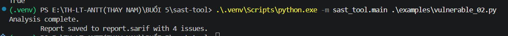

*Hình 12. Terminal xác nhận phân tích file thứ hai với 4 kết quả.*

Chưa có ảnh SARIF Viewer riêng cho lần quét này. Mã ví dụ có `exec()`, nhưng bộ luật hiện tại chưa phát hiện lời gọi này; bốn kết quả không có cảnh báo `exec()`.

### 5.8. Kết luận phần SAST

Các minh chứng xác nhận môi trường SAST, **6 Unit Test thành công**, hai lượt quét trả về **8** và **4** kết quả, cùng việc nạp báo cáo vào Viewer. Phạm vi phát hiện còn hẹp: chỉ nhận diện lời gọi `eval()` trực tiếp và hai mẫu regex; chưa phân tích luồng dữ liệu. Test lint cho phép danh sách rỗng, test reporter chỉ kiểm tra file tồn tại, nên kết quả OK chưa chứng minh tính đầy đủ của phát hiện hay tính hợp chuẩn SARIF. Bộ phân tích đầu ra `flake8` cũng cần được lưu ý khi truyền đường dẫn Windows tuyệt đối có dấu `:`; các lệnh minh chứng dùng đường dẫn tương đối.

## 6. PHẦN II – DAST-TOOL

### 6.1. Giới thiệu DAST-TOOL

Project minh họa việc lấy số liệu của tiến trình hiện tại, thống kê mạng theo giao diện và công bố kết quả qua API. Các phép kiểm tra bộ nhớ, hành vi và thư mục tạm là ví dụ cơ bản của bài lab, không đủ để kết luận phát hiện toàn diện lỗi bộ nhớ hoặc mã độc.

### 6.2. Các thành phần của DAST-TOOL

| Thành phần | Chức năng thực tế và giới hạn |
|---|---|
| `RuntimeMonitor` | Đọc CPU, RSS RAM và file mở của một PID bằng `psutil` |
| `MemoryAnalyzer` | Gọi `gc.collect()`, lọc `gc.garbage` và so sánh số nguyên với ngưỡng `2**63`; không phát hiện buffer overflow thực tế |
| `NetworkTrafficAnalyzer` | Đọc bộ đếm byte/gói theo giao diện mạng của hệ thống; chưa bắt gói hoặc liệt kê kết nối socket |
| `SecurityBehaviorChecker` | Tìm ba chuỗi `os.system`, `eval`, `exec` trong chính file module; các chuỗi nằm ngay trong danh sách mẫu nên kết quả không chứng minh các lời gọi đã được thực thi |
| `VirtualSandbox` | Chấp nhận dạng `echo` với chữ, số, khoảng trắng; dùng Python in chuỗi trong thư mục tạm, không gọi shell, có timeout 5 giây; không cách ly hệ điều hành |

### 6.3. Cài đặt môi trường

```powershell
Set-Location -LiteralPath 'E:\TH-LT-ANTT(THAY NAM)\BUỔI 5\dast-tool'
# Chỉ thực hiện dòng sau nếu chưa có .venv:
python -m venv .venv
.\.venv\Scripts\python.exe -m pip install -r .\requirements.txt
.\.venv\Scripts\python.exe -m pip show psutil Flask
.\.venv\Scripts\python.exe -m pip check
```

Dependencies chính là `psutil` và `Flask`. Kiểm tra môi trường hiện tại xác nhận các phiên bản ở mục 2; bộ ảnh chưa có ảnh riêng về lệnh cài đặt hoặc `pip check` của DAST.

### 6.4. Kiểm thử Unit Test

**Mục đích:** kiểm tra phép so sánh ngưỡng số nguyên, kiểu dữ liệu thống kê mạng, CPU/RAM, danh sách chuỗi nghi ngờ và đầu ra ví dụ `echo test`.

```powershell
.\.venv\Scripts\python.exe -m unittest discover -s tests -v
```

**Kết quả thực tế:** **5 test**, **1,074 giây**, kết thúc **OK**.

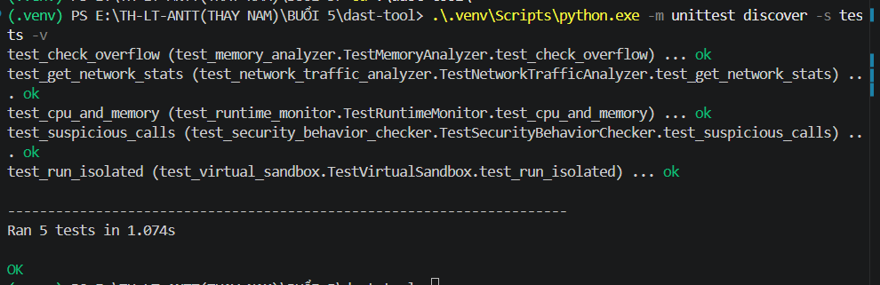

*Hình 13. Kết quả kiểm thử năm module DAST.*

### 6.5. Chạy chương trình main.py

```powershell
.\.venv\Scripts\python.exe .\main.py
```

**Kết quả thực tế trong ảnh 14:**

| Chỉ số / chức năng | Giá trị nhìn thấy |
|---|---|
| PID | 28616 |
| CPU | **0.0%** |
| RAM (RSS) | **19.607.552 byte** |
| File đang mở | Một file tài nguyên hệ thống `KernelBase.dll.mui` |
| Memory Leaks | `[]` |
| Overflow Test | `True`, ứng với giá trị mẫu `2**64` |
| Network Stats | Các giao diện Ethernet, Wi-Fi 2 và Loopback Pseudo-Interface 1 |
| Suspicious Calls | `['os.system', 'eval', 'exec']` |
| Sandbox stdout | `Hello Sandbox` |
| Sandbox stderr | Trống |

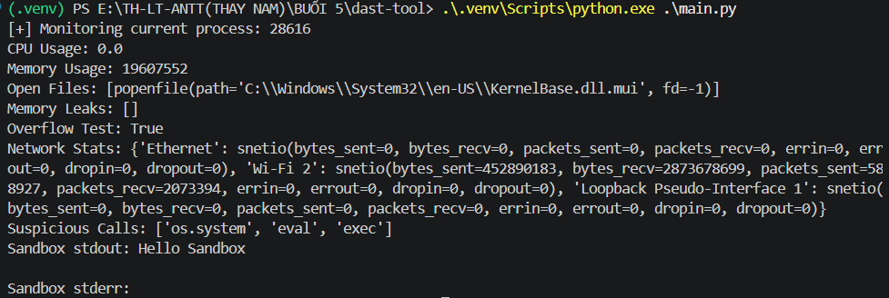

*Hình 14. Số liệu tài nguyên và kết quả các phép kiểm tra mẫu tại thời điểm chạy.*

`[]` không khẳng định chương trình không có rò rỉ bộ nhớ; `True` chỉ phản ánh phép so sánh ngưỡng. Python hỗ trợ số nguyên lớn, nên kết quả này không chứng minh đã xảy ra tràn bộ đệm.

### 6.6. Khởi động Flask API

Trong terminal tại `dast-tool`, chạy:

```powershell
.\.venv\Scripts\python.exe .\app.py
```

Mã hiện tại cấu hình địa chỉ **127.0.0.1**, cổng **5000**, tương ứng `http://127.0.0.1:5000`. Giữ terminal server mở và dùng trình duyệt hoặc terminal thứ hai để gửi yêu cầu.

**Minh chứng hiện có:** các ảnh 16, 18, 20, 22 và 26 bên dưới ghi log yêu cầu **HTTP 200**. Chưa có ảnh phần thông báo khởi động server; do đó không trích một kết quả terminal khởi động giả định. API phục vụ trên localhost theo cấu hình hiện tại.

### 6.7. Kiểm thử các API

Các JSON bên dưới được chép từ ảnh khi đọc đủ nội dung. HTTP Status Code được đối chiếu riêng với log Flask. Riêng POST thành công chưa có JSON nguyên văn vì PowerShell hiển thị kết quả dưới dạng bảng và rút gọn chuỗi.

#### 6.7.1. GET /api/monitor

**Mục đích:** đọc CPU, RAM và file mở của tiến trình Flask.

**Thao tác đã thể hiện:** mở `http://127.0.0.1:5000/api/monitor` trên trình duyệt. Lệnh PowerShell tương đương:

```powershell
Invoke-RestMethod -Uri 'http://127.0.0.1:5000/api/monitor' -Method GET | ConvertTo-Json -Depth 5
```

**Kết quả JSON thực tế:**

```json
{
  "cpu_usage": 0.0,
  "memory_usage": 43438080,
  "open_files": ["C:\\Windows\\System32\\en-US\\KernelBase.dll.mui"]
}
```

**HTTP Status Code: 200.** RAM tại thời điểm chụp là **43.438.080 byte**.

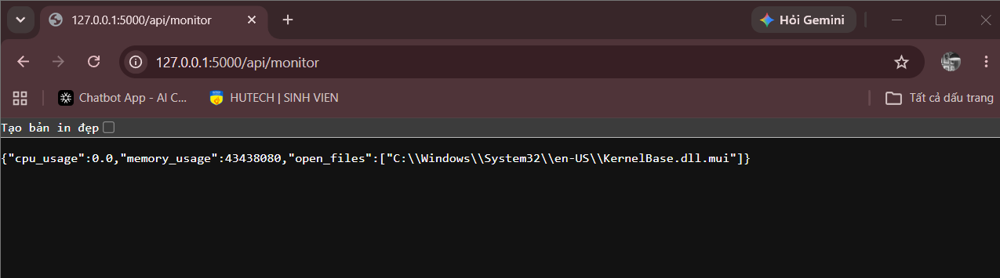

*Hình 15. Phản hồi giám sát tiến trình Flask trên trình duyệt.*

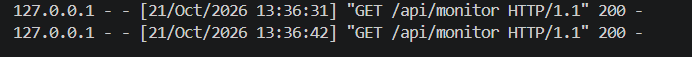

*Hình 16. Hai yêu cầu GET `/api/monitor` đều trả mã 200.*

#### 6.7.2. GET /api/memory

**Mục đích:** xem kết quả lọc đối tượng GC và phép so sánh giá trị mẫu.

**Thao tác:** mở `http://127.0.0.1:5000/api/memory` hoặc dùng:

```powershell
Invoke-RestMethod -Uri 'http://127.0.0.1:5000/api/memory' -Method GET | ConvertTo-Json
```

**Kết quả JSON thực tế:**

```json
{"memory_leaks": "[]", "overflow_test": true}
```

**HTTP Status Code: 200.** `memory_leaks` là **chuỗi** `"[]"` do mã gọi `str()`, không phải mảng JSON.

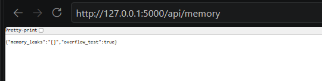

*Hình 17. Kết quả kiểm tra bộ nhớ và giá trị vượt ngưỡng.*

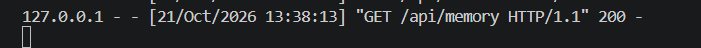

*Hình 18. Mã phản hồi 200 của `/api/memory`.*

#### 6.7.3. GET /api/network

**Mục đích:** lấy bộ đếm lưu lượng trên từng giao diện mạng.

**Thao tác:** mở `http://127.0.0.1:5000/api/network` hoặc dùng:

```powershell
Invoke-RestMethod -Uri 'http://127.0.0.1:5000/api/network' -Method GET | ConvertTo-Json -Depth 5
```

**Kết quả JSON thực tế trong ảnh 19** được trình bày lại với thụt lề:

```json
{
  "network_stats": {
    "Ethernet": {
      "bytes_recv": 0, "bytes_sent": 0,
      "dropin": 0, "dropout": 0, "errin": 0, "errout": 0,
      "packets_recv": 0, "packets_sent": 0
    },
    "Loopback Pseudo-Interface 1": {
      "bytes_recv": 0, "bytes_sent": 0,
      "dropin": 0, "dropout": 0, "errin": 0, "errout": 0,
      "packets_recv": 0, "packets_sent": 0
    },
    "Wi-Fi 2": {
      "bytes_recv": 2898412132, "bytes_sent": 559708202,
      "dropin": 0, "dropout": 0, "errin": 0, "errout": 0,
      "packets_recv": 2197345, "packets_sent": 601538
    }
  }
}
```

**HTTP Status Code: 200.** Đây là bộ đếm của giao diện mạng hệ thống, không phải lưu lượng riêng của ứng dụng hay danh sách kết nối đang mở.

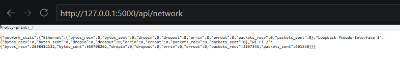

*Hình 19. Phản hồi thống kê mạng theo giao diện.*

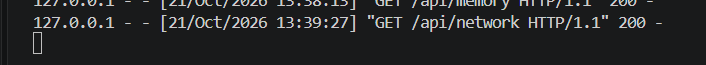

*Hình 20. Yêu cầu GET `/api/network` trả mã 200.*

#### 6.7.4. GET /api/security

**Mục đích:** trả danh sách chuỗi mẫu tìm thấy trong module kiểm tra hành vi.

**Thao tác:** mở `http://127.0.0.1:5000/api/security` hoặc dùng:

```powershell
Invoke-RestMethod -Uri 'http://127.0.0.1:5000/api/security' -Method GET | ConvertTo-Json
```

**Kết quả JSON thực tế:**

```json
{"suspicious_calls": ["os.system", "eval", "exec"]}
```

**HTTP Status Code: 200.** Kết quả phản ánh việc tìm chuỗi trong chính file nguồn, không phải dấu vết gọi hàm trong runtime.

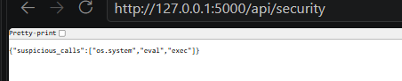

*Hình 21. Danh sách ba chuỗi mẫu trả về từ endpoint security.*

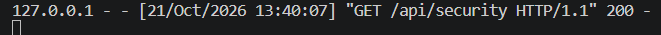

*Hình 22. Mã phản hồi 200 của `/api/security`.*

#### 6.7.5. POST /api/sandbox

**Mục đích:** gửi ví dụ `echo Hello Sandbox` đến chức năng chạy thử có giới hạn đầu vào. Chức năng này không tạo máy ảo hay cách ly hoàn toàn hệ điều hành.

**Lần thử chưa thành công:** ảnh 24 ghi lệnh `curl.exe` và phản hồi **HTTP 400 BAD REQUEST**:

```json
{"error": "Only echo followed by plain text is allowed."}
```

Ảnh không đủ dữ liệu để xác định chính xác JSON đã đến server như thế nào. Theo mã nguồn, thông báo này xuất hiện khi `command` không phải chuỗi hoặc không khớp mẫu cho phép. Không dùng ảnh này để khẳng định lệnh `echo Hello Sandbox` bị cấm hay đã kiểm thử đầy đủ khả năng chống command injection.

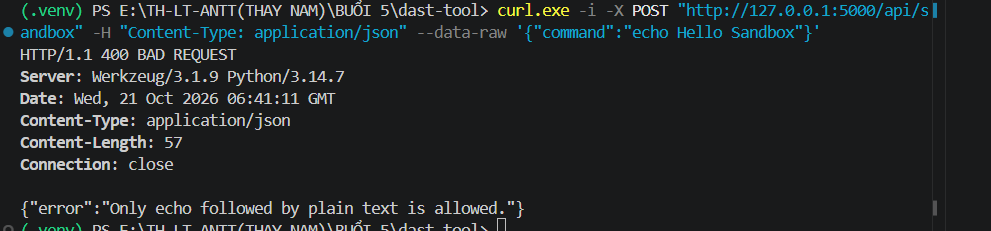

*Hình 24. Lần gửi yêu cầu chưa thành công và nội dung lỗi thực tế.*

**Cách kiểm thử thành công trong ảnh 25:** tạo JSON bằng `ConvertTo-Json`, gửi bằng `Invoke-RestMethod`:

```powershell
$body = @{
    command = 'echo Hello Sandbox'
} | ConvertTo-Json

Invoke-RestMethod `
    -Uri 'http://127.0.0.1:5000/api/sandbox' `
    -Method POST `
    -ContentType 'application/json' `
    -Body $body
```

**Kết quả thực tế:** bảng PowerShell có hai cột `stderr` và `stdout`; `stderr` trống, `stdout` hiển thị rút gọn **`Hello Sandb...`**. Log Flask xác nhận **HTTP Status Code: 200**. Chưa có đủ nội dung để trích phản hồi JSON thành công nguyên văn. Mã nguồn trả hai trường `stdout`, `stderr`, nhưng cấu trúc trong mã không thay thế được minh chứng nội dung đầy đủ.

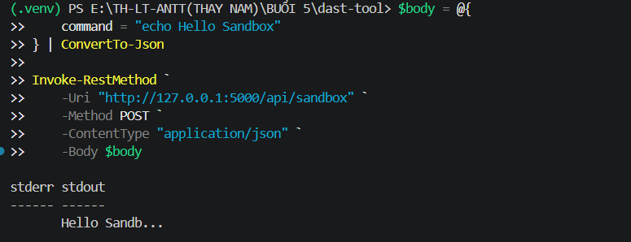

*Hình 25. Yêu cầu POST bằng PowerShell; phần stdout trong bảng bị rút gọn.*

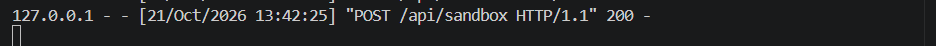

*Hình 26. Server trả mã 200 cho yêu cầu POST `/api/sandbox`.*

Để thu thêm JSON đầy đủ trong một lần kiểm thử sau, có thể thêm `| ConvertTo-Json -Depth 5` vào cuối lệnh `Invoke-RestMethod`. Đây là hướng dẫn bổ sung, chưa được tính là kết quả đã có trong bộ ảnh.

### 6.8. Kết luận phần DAST

Bộ ảnh xác nhận **5 Unit Test thành công**, chương trình giám sát xuất dữ liệu và cả **5 endpoint** có yêu cầu trả **HTTP 200**. POST sandbox còn có một lần trả **400** trước lần gửi thành công bằng PowerShell. Phân tích bộ nhớ chỉ là heuristic đơn giản; bộ đếm mạng không phải phân tích gói tin; tìm chuỗi không phải giám sát system call; thư mục tạm không phải sandbox bảo mật. Các test chủ yếu kiểm tra kiểu dữ liệu và ví dụ cơ bản, chưa chứng minh độ bao phủ bảo mật của công cụ.

## 7. Rà soát trước khi xuất bản

Mã nguồn, cấu hình, README và đủ **26 ảnh** đã được rà soát trước khi xuất bản. Không phát hiện bí mật thật trong bộ file Lab 5 được kiểm tra. Các chuỗi mật khẩu trong ví dụ SAST và test pattern matching là dữ liệu giả lập được tạo theo bài lab, không dùng để đăng nhập dịch vụ; giữ nguyên để kiểm thử khả năng phát hiện.

`.gitignore` loại trừ môi trường ảo, cache, file môi trường, khóa riêng, cấu hình editor và file tạm; vẫn giữ mã Python, Unit Test, cấu hình luật, requirements, SARIF và ảnh minh chứng. Không sửa các file Python hoặc nội dung ảnh trong quá trình chuẩn bị xuất bản.

Theo dõi nội dung tại [thư mục lab5 trên GitHub](https://github.com/Chu-07/TH-LTANTT-2387700062/tree/main/lab5) và [lịch sử thay đổi lab5](https://github.com/Chu-07/TH-LTANTT-2387700062/commits/main/lab5). Bộ 26 ảnh thực hành chưa có ảnh chụp thao tác Git; không dùng các ảnh này để chứng minh commit hoặc push.

### Minh chứng cần xác minh

`lab5-23.png` là PNG hợp lệ nhưng chỉ có kích thước **2 × 10 pixel**, không nhận diện được thao tác hay kết quả. File được giữ nguyên để bảo toàn bộ ảnh gốc, không tính là bằng chứng cho một kiểm thử thành công.


*Hình 23. Chưa xác định – cần kiểm tra; cần ảnh chụp đầy đủ nếu muốn sử dụng làm minh chứng.*
